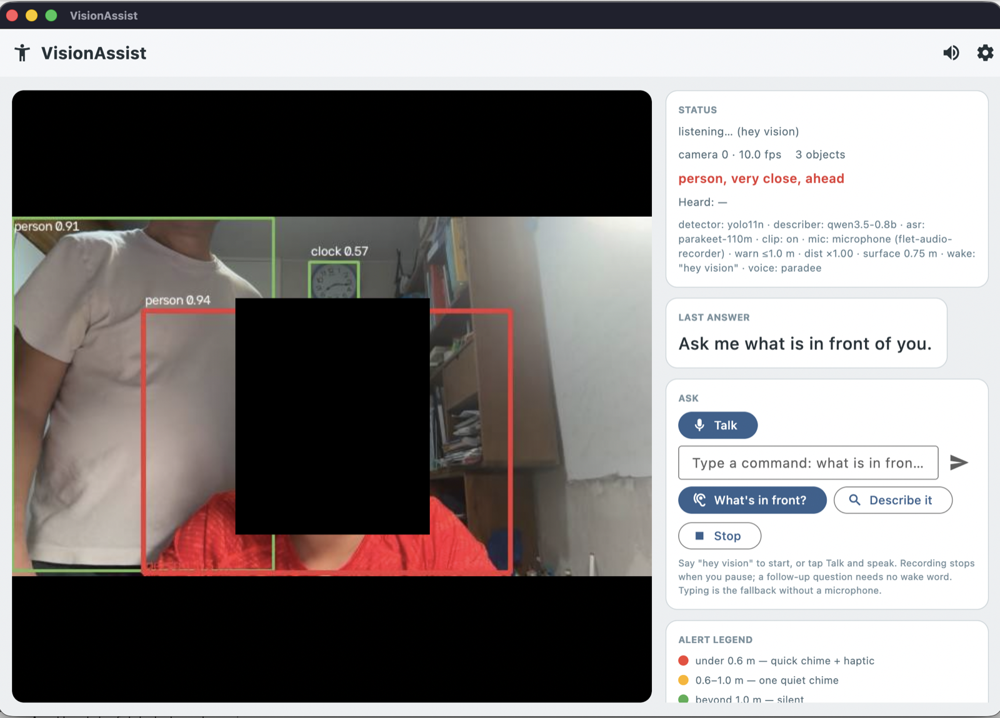

<!-- Author: David Li, SISHK -->

# VisionAssist

A wearable-style assistant for blind and low-vision users. A camera watches the
path ahead, **warns with quiet non-verbal sounds before something becomes an
obstacle**, and answers spoken questions about what is in front of the user.

> **The app does not need an internet connection.** All AI models are embedded
> locally in `src/assets/models/` and run on-device with ONNX Runtime /
> sherpa-onnx. There are no API keys, no cloud inference, no telemetry, and no
> runtime downloads. PyTorch and transformer runtimes are not needed.



*Live preview with YOLO boxes, distance status, the answer panel, and the
1.0 m / 0.6 m alert legend.*

## 1. What the project is about

VisionAssist is a [Flet](https://flet.dev) demo for a head-mounted or
phone-based visual assistant. The intended user is a blind person walking with
a camera, microphone and speaker; the current demo runs on a laptop and is
designed for an Android phone later.

The design principle is **sound only when it helps**:

- The path is monitored continuously, but the assistant stays quiet for objects
  farther than the configured warning distance (default **1.0 m**).
- Warnings are short two-note chimes, not alarms. Rhythm encodes distance,
  stereo balance encodes direction, and pitch encodes floor/waist/head height.
- Spoken answers are used only when the user asks a question. A soft earcon
  acknowledges a request while a model thinks.
- Everything runs on-device; wake speech is transcribed locally and is never
  uploaded or written to disk.

### No internet connection required

The running app is **fully offline**:

- The YOLO detector, Silero VAD, Parakeet ASR, Paradee TTS, MobileCLIP2-B and
  Qwen3.5 VLM are all embedded as local ONNX files in `src/assets/models/`.
- No image, audio or transcript is sent to a server. There is no cloud model,
  no API key, and no telemetry.
- Once the app and models are installed, the camera, warnings, wake word,
  speech recognition, search and spoken answers work with the network cable
  unplugged.

Internet is needed only for the **one-time installation**, not for using the
app: cloning the repository, installing Python packages, downloading the model
weights, and (for a source checkout) Flet’s first-run desktop client download.
A packaged desktop/Android build contains the client and the model weights, so
it starts offline. The web build is UI-only and intentionally excludes the
models. If you are installing on an offline machine, copy
`src/assets/models/` from a prepared machine or download the wheels/models
first.

## 2. The three main functions

### 1. Non-verbal obstacle warnings

The camera frame goes through YOLO11n, a small tracker, a walking-corridor
filter, and ground-plane distance geometry. An object that is confirmed and
inside the middle of the view can trigger a chime:

- **beyond 1.0 m** — silent (the default `alert_near_m`);
- **0.6–1.0 m** — one quiet chime (`alert_close_m`);
- **under 0.6 m** — a quicker, higher-urgency pattern;
- a box that fills most of the frame or is clipped by the bottom edge is
  reported as **“very close”** even when geometry has no usable floor point.

The default is deliberately a soft chime, never a buzzer. Alert styles are
`soft`, `ticks`, `voice`, `haptic`, and `off`. The chime **ducks to 12 % while
the user speaks** and restores afterwards, so it cannot mask the wake phrase or
a question.

### 2. Spoken scene questions and descriptions

Say **“Hey Vision”** and then ask, or tap **Talk** / shake the phone:

- “What is in front of me?” → a terse list of the largest objects, their
  distance, and their direction.
- “Is there a cup?” / “Where is the chair?” → answered from live frames, with
  everyday words mapped to COCO labels (`mug` → `cup`, `sofa` → `couch`).
- “Describe it” / “What colour is the cup?” → Qwen3.5-0.8B describes the
  largest object (or the named object) in one short sentence.
- “Find my keys” / “I’m looking for a mug” → starts a 12-second panning search
  using MobileCLIP2-B, then announces position and distance when it sees a
  stable match.

Silero VAD segments speech, Parakeet TDT 110M transcribes it, and Paradee-8M
speaks the answer. A follow-up can be asked without the wake phrase for 6
seconds after an answer.

### 3. Settings, accessibility and control

Everything is adjustable live from the gear menu: detection confidence,
minimum object size, warning/close distances, alert style and volume, camera
height/tilt/FOV, surface height, distance calibration, voice/speed, wake
phrase, greeting name, and the description/ASR backend. Settings persist to
the user config directory.

Accessibility fallbacks are always available: **Talk** button, **shake to
talk** (mobile), and a typed command box. Wake is never the only way to start
a request.

## 3. Modules and AI models

### AI models

All weights live in `src/assets/models/` and are gitignored; `tools/fetch_models.py`
downloads them. The default bundle is about **169 MB**; the optional vision
bundles add about **1.3 GB**.

| Model | Role | Files | Size | Licence |
| --- | --- | --- | ---: | --- |
| **YOLO11n** | Object detection, 80 COCO classes | `yolo11n/yolo11n.onnx` + `config.json` | 10.7 MB | AGPL-3.0 (Ultralytics) |
| **Silero VAD** int8 | Speech activity / end-of-utterance | `silero-vad/silero_vad.onnx` | 0.6 MB | MIT |
| **Parakeet TDT 110M** int8 | Speech recognition (default ASR) | `asr-parakeet-110m/*.int8.onnx` + `tokens.txt` | 136 MB | **CC-BY-4.0, NVIDIA** |
| **Paradee-8M v1.3** int8 | Text to speech, 24 kHz | `paradee/paradee_int8.onnx` + `config.json` | 8.5 MB | Apache-2.0 |
| **misaki English G2P** | Grapheme-to-phoneme for Paradee | `g2p/{us,gb}_{gold,silver}.json` | 12.6 MB | Apache-2.0 |
| **MobileCLIP2-B** | Open-vocabulary image/text search (optional) | `mobileclip2-b/image.onnx` + data, `text.onnx` + data | 578 MB | `apple-amlr` (research) |
| **Qwen3.5-0.8B** q4 ONNX | Vision-language descriptions and questions (optional) | `qwen3.5-0.8b/onnx/*_q4.onnx` + data | 737 MB | Apache-2.0 |

Provenance, exact file names and source URLs are in
[`src/assets/models/README.md`](src/assets/models/README.md).

### Python runtime and modules

| Dependency | Why |
| --- | --- |
| `flet` 1.1.2 | UI, desktop/web/Android client |
| `flet-audio` | speech playback and looping alert chimes |
| `flet-audio-recorder` | microphone capture (PCM/WAV), permissions |
| `onnxruntime` | CPU inference for every model above |
| `sherpa-onnx` | Silero VAD and Parakeet/zipformer ASR |
| `numpy` | frames, audio, embeddings, earcon synthesis |
| `opencv-python-headless` | camera capture, resize, JPEG, drawing |
| `tokenizers` | MobileCLIP and Qwen tokenizers |
| `platformdirs` | per-user settings path |
| `pytest`, `pytest-asyncio` | tests (no camera/audio needed) |
| `flet-cli`, `flet-desktop`, `flet-web` | `flet run` / `flet build` helpers |
| `pyarrow`, `ffmpeg` | optional ASR benchmark only |
| `sounddevice` | dev-only microphone fallback for `tools/test_wake.py` |

Project layout:

```
src/domain/      pure Python: types, distance bands, HazardMonitor, scene text,
                 intent rules, Settings; no Flet/numpy/cv2/onnx imports
src/adapters/    I/O and models: capture (OpenCV), detection (YOLO + tracker),
                 speech (Paradee, g2p, VAD, ASR, microphone), models (VLM, CLIP)
src/app/         Assistant: perception loop, alert policy, intents, search
src/ui/          Flet UI: AppBar, preview, panels, settings dialog, FletSpeaker
tools/           model fetch, packaging, ASR benchmark, wake probe, APK patch
tests/           210 unit tests; model tests skip if their assets are absent
```

## 4. Download and install

### Requirements

- Python **3.11+** (tested with 3.13.16; 3.14 also works with the current
  `onnxruntime`/`sherpa-onnx` wheels).
- A camera that OpenCV can open (built-in webcam, USB camera, or `/dev/video*`)
  and a microphone/speaker.
- **64-bit OS** for Raspberry Pi/SBC installs: there are no 32-bit
  `onnxruntime`/`sherpa-onnx` wheels.
- About **2 GB free disk** for the core app + models; **3.5 GB** with the
  optional vision bundles.

### 1. Clone and install

```bash
git clone https://github.com/Plumpplump/vision-assistant.git
cd vision-assistant

python3 -m venv .venv
source .venv/bin/activate           # Windows: .venv\Scripts\activate
python -m pip install --upgrade pip
pip install -e .
pip install flet-cli flet-desktop flet-web
```

Linux (Debian/Ubuntu/Raspberry Pi OS) may also need the Flet audio runtime:

```bash
sudo apt update
sudo apt install -y python3-venv libmpv2 libgstreamer1.0-0 \
    gstreamer1.0-plugins-base gstreamer1.0-plugins-good
```

### 2. Download the AI models

```bash
python tools/fetch_models.py             # core: YOLO, VAD, Parakeet, Paradee, g2p (~169 MB)
python tools/fetch_models.py --vision    # optional: MobileCLIP2-B + Qwen (~1.3 GB more)
python tools/fetch_models.py --partials  # optional: streaming zipformer (~73 MB)
python tools/fetch_models.py --verify    # load YOLO/TTS and transcribe one sentence
```

The script uses the sibling projects if they exist, otherwise downloads the
canonical Hugging Face / misaki sources. It is safe to re-run; files with the
wrong size are refreshed. To keep a small install (especially on a Pi), use
only the core command.

This is the **only** network-dependent step apart from the initial package
install. Once `src/assets/models/` is populated you can disconnect the machine
and run the app offline. To prepare an offline install elsewhere, copy both the
prepared `.venv` (or wheelhouse) and `src/assets/models/` to the target, or
build an APK/desktop package on a connected machine first.

### 3. Run

```bash
flet run                         # desktop window, hot reload
flet run --web                   # browser UI only; no ONNX in Pyodide
VISIONASSIST_SOURCE=demo flet run    # synthetic camera feed (no webcam)
VISIONASSIST_SOURCE=/path/clip.mp4 flet run   # replay a video file
```

The first run loads the voice (about a second) and Parakeet; the VLM is loaded
lazily on the first “describe it” or free-form question.

### Quick checks

```bash
python -m pytest -q              # 210 tests; camera/audio device not required
python tools/test_wake.py --say "hey vision"   # acoustic wake diagnostic
python tools/audition_alerts.py  # render every alert sound to WAV
```

## 5. Platform support

The code is portable Python + ONNX Runtime + Flet. The macOS laptop demo is the
configuration used during development; the same source runs on the other
platforms below.

| Platform | Status | Notes |
| --- | --- | --- |
| **macOS 12+** (Apple Silicon/Intel) | ✅ tested | `flet run`; uses a WAV-file microphone path because Flet’s macOS streaming PCM returns silence |
| **Windows 10/11 (x64)** | ✅ supported | same install; OpenCV camera, Flet audio |
| **Linux x86_64** (Debian/Ubuntu/Fedora/Arch) | ✅ supported | install the Flet audio runtime packages above |
| **Raspberry Pi 4/5, 64-bit** | ⚠️ experimental | use the Linux desktop path and the **core** model profile; Pi 4 is CPU-only and slower, Pi 5/8 GB can try `--vision` |
| **Other arm64 SBCs** (Orange Pi 5, Radxa Rock 5, Jetson Orin in CPU mode) | ⚠️ experimental | 64-bit OS, aarch64 wheels, V4L2 camera; same core profile |
| **Android 7+ (API 24)** | ⚠️ APK installable | UI/audio work; camera capture still needs a `flet-camera` source because OpenCV cannot open the Android camera |
| **Web** | ⚠️ UI only | `flet run --web` / `flet build web`; Pyodide has no `onnxruntime`, so no models |
| **iOS** | not currently packaged | would need an iOS build and a camera source |

### Raspberry Pi / single-board computer instructions

Use a **64-bit** Raspberry Pi OS (Bookworm) or Ubuntu 22.04/24.04 arm64 image,
then:

```bash
uname -m                    # must print aarch64
python3 --version           # 3.11+
sudo apt update
sudo apt install -y python3-venv libmpv2 libgstreamer1.0-0 \
    gstreamer1.0-plugins-base gstreamer1.0-plugins-good
python3 -m venv .venv
source .venv/bin/activate
pip install -e .
pip install flet-cli flet-desktop
python tools/fetch_models.py       # core profile
flet run
```

Guidance:

- **4 GB RAM**: core models only; keep the camera preview at 640 px and expect
  lower detection FPS than a laptop.
- **8 GB RAM (Pi 5 recommended)**: you can try `fetch_models.py --vision`;
  Qwen descriptions will be several times slower than on a laptop CPU.
- For a headless/kiosk build, use `flet build linux -v`; for the quickest path,
  `flet run` uses Flet’s prebuilt Linux arm64 client.
- If no camera is available, use `VISIONASSIST_SOURCE=demo`.
- On Linux, if the microphone is silent, try `VISIONASSIST_MIC_MODE=file` or
  `VISIONASSIST_MIC_MODE=stream` and check the `[asr]`/`[wake]` logs.
- Install once while connected, then the Pi can run fully offline; the models
  and the Flet Linux client are cached locally.

### Android

```bash
python tools/package_models.py --profile apk    # 169 MB core assets
flet build apk -v
python tools/patch_android_apk.py               # sherpa-onnx libc++ shim
adb install -r build/flutter/build/app/outputs/flutter-apk/app-arm64-v8a-release-patched.apk
python tools/package_models.py --profile full   # restore Qwen/CLIP locally
```

The APK declares `RECORD_AUDIO` and `MODIFY_AUDIO_SETTINGS`. Camera access is
still desktop-only until a `flet-camera` frame source replaces OpenCV on the
phone; do not add a CAMERA permission before that source exists.

## 6. Using it

- **“Hey Vision, what is in front of me?”** — one wake phrase plus a request.
  If the alert chime is playing it ducks to 12 % as soon as speech is detected.
- **Talk** — tap, speak, pause: VAD ends the recording about 0.8 s after you
  stop. On a phone, **shake** to talk.
- **Follow-ups** — after an answer, commands such as “describe it” or “where is
  it” are accepted for 6 seconds without the wake phrase.
- **Find** — “I’m looking for my keys” starts a 12-second search; pan the camera
  slowly and it announces left/centre/right when it finds a stable match.
- **Stop / mute / help** — voice control and discovery.
- **Settings** — gear icon; changes apply live and persist.

### Distance and calibration (important)

The default warning is **1.0 m** and the close warning is **0.6 m**. The object
must also be in the middle third of the view.

If the app warns at roughly **2 m**, the warning threshold is not 2 m; the
distance estimate is under-reporting. Fix it in **Settings → Distance scale**:

1. Put an object at a tape-measured distance (for example 1.0 m).
2. Read **Current estimate** in the dialog.
3. Type the real distance and press **Calibrate**.

The status line shows `warn ≤1.0 m` and `dist ×…` so you can confirm the active
settings. The “Laptop on a desk” preset uses a 1.1 m camera and a 0.75 m desk
surface; a floor-facing wearable should use the “Wearable” preset (1.0 m
camera, floor geometry) and leave the scale at 1.0.

**Very close objects.** When someone sits 40 cm away their feet fall below the
frame and geometry saturates near 1 m. A box filling ≥75 % of the frame height,
or a large box whose bottom is in the lowest ~1.5 % of the frame, is reported as
“very close” instead.

## 7. Wake word, microphone and privacy

“Hey Vision” is detected by transcribing VAD-segmented utterances locally and
matching the phrase (with tolerance for “visions”, “vison”, “day vision”).
Nothing is sent to a server or written to disk; wake can be disabled in
Settings. The planned acoustic wake-word model is described in
[`docs/wake-word.md`](docs/wake-word.md).

The microphone path is:

```
Assistant.listen() -> FletAudioRecorderMicrophone -> Silero VAD trim -> Parakeet
```

On macOS, `flet-audio-recorder`’s streaming PCM path returns silent buffers, so
the adapter records a WAV file and feeds its growing data chunk to the VAD.
`VISIONASSIST_MIC_MODE=file|stream` overrides the choice for debugging. The
wake loop keeps a long capture window open (VAD ends the utterance), avoiding
gaps that could swallow “Hey Vision”.

Every recording logs one line such as:

```
[asr] recorded 3.10s (rms 0.040, peak 0.25), speech 1.29s
[asr] parakeet-110m 0.11s -> 'What is in front of me?'
```

- `rms` below ~0.005 means the microphone is silent: check OS input level and
  permission.
- `speech 0.00s` means VAD heard no speech.
- `[wake] heard '…'` shows the transcript; `[wake] ignored: no wake phrase`
  means the phrase was not matched.

## 8. Tests, packaging and sizes

```bash
python -m pytest                 # 210 tests
```

`test_yolo.py`, `test_paradee.py`, `test_asr.py`, `test_clip.py` and
`test_qwen.py` auto-skip when their model assets are missing.
`tests/test_asr.py` also exercises VAD trimming and Parakeet on
Paradee-synthesised speech. There is no Flutter integration test because
`cmake` is not installed on the development machine.

Packaging profiles (Flet copies everything under `src/assets` into the app):

| Profile | Assets | Contents |
| --- | ---: | --- |
| `apk` | 169 MB | YOLO, Paradee + g2p, Silero, Parakeet |
| `apk-vision` | 907 MB | adds Qwen VLM |
| `apk-full` | 1.5 GB | adds MobileCLIP2-B and Qwen |
| `full` | 1.5 GB | restores optional bundles for local work |

```bash
python tools/package_models.py --profile apk
flet build apk -v
python tools/patch_android_apk.py
python tools/package_models.py --profile full
```

The web build excludes `assets/models` because the browser runtime has no
ONNX Runtime.

## 9. Credits

- **YOLO11n** — Ultralytics, AGPL-3.0.
- **MobileCLIP2-B** — Apple, `apple-amlr` research licence; review before
  distribution.
- **Paradee-8M v1.3** — Apache-2.0; English G2P data from
  [`hexgrad/misaki`](https://github.com/hexgrad/misaki).
- **Parakeet TDT 110M** — NVIDIA, **CC-BY-4.0**; attribution is required in
  shipped builds. sherpa-onnx export by the k2-fsa team.
- **Streaming zipformer** (optional) — Apache-2.0, k2-fsa / icefall.
- **Silero VAD** — MIT.
- **Qwen3.5-0.8B** — Apache-2.0.
- Built with [Flet](https://flet.dev), [ONNX Runtime](https://onnxruntime.ai)
  and [sherpa-onnx](https://github.com/k2-fsa/sherpa-onnx).

Author: **David Li, SISHK**.
